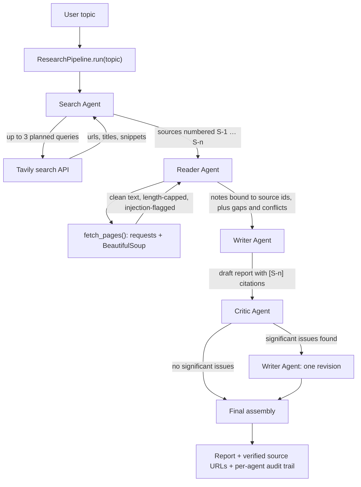
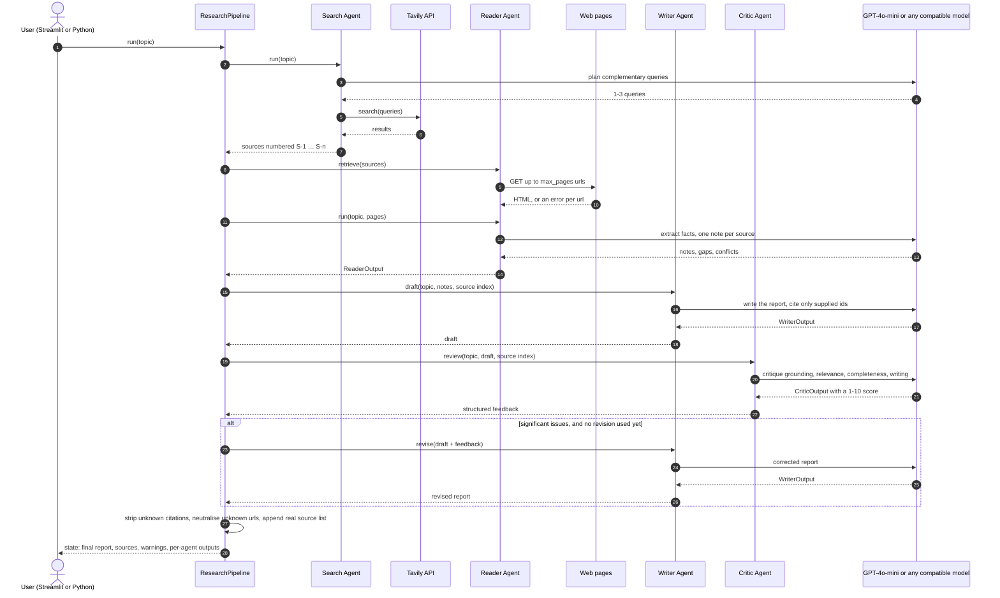
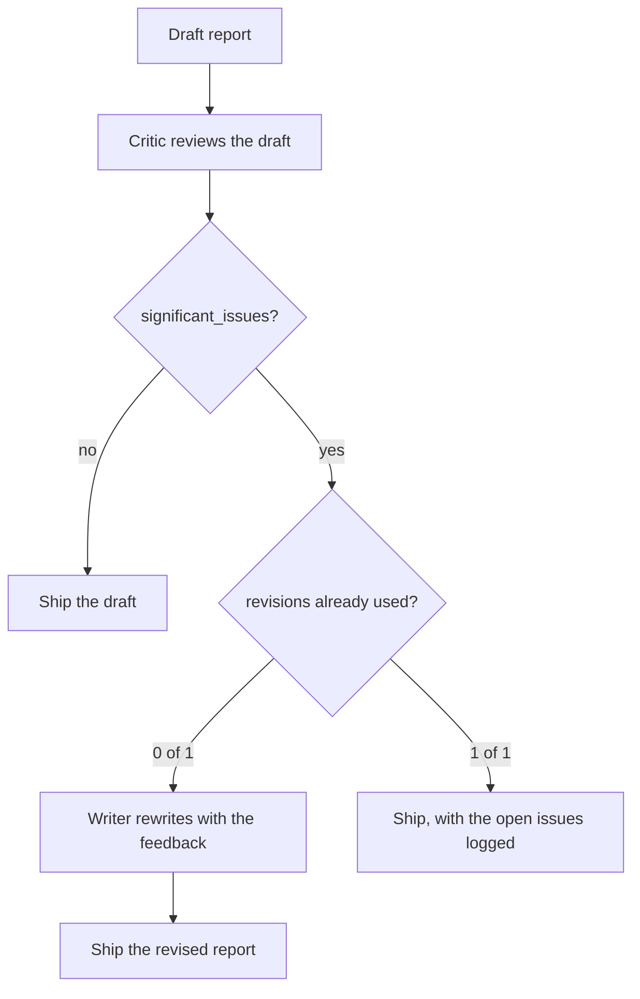
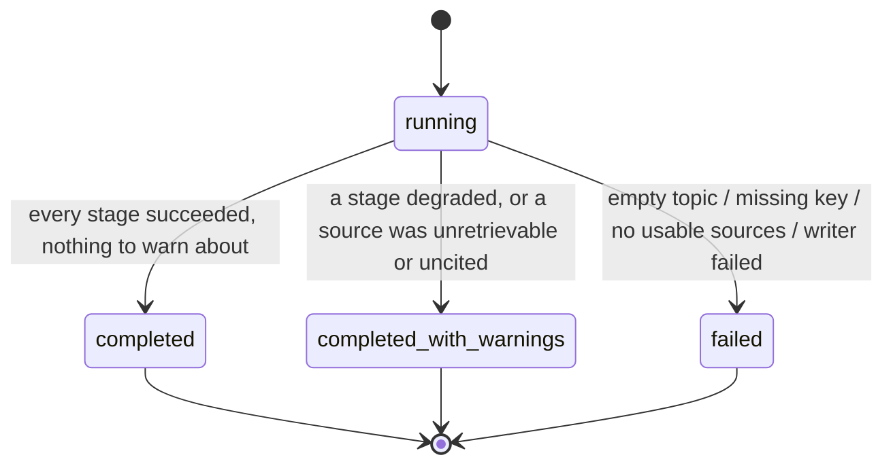

# Multi-Agent Research System

**Four cooperating AI agents research a topic you type in and produce a report in which
every important claim is tied to a source that was actually downloaded.**

Python · LangChain · Tavily · Streamlit · Pydantic — works with GPT-4o-mini or any
OpenAI-compatible model provider.

```
topic ─► Search ─► Reader ─► Writer ─► Critic ─► (one revision at most) ─► report + sources
```

---

## Contents

- [What this is](#what-this-is)
- [How the system works](#how-the-system-works)
  - [1. The whole run at a glance](#1-the-whole-run-at-a-glance)
  - [2. Who talks to whom, in order](#2-who-talks-to-whom-in-order)
  - [3. How a claim stays tied to a source](#3-how-a-claim-stays-tied-to-a-source)
  - [4. The review loop, and why it cannot run away](#4-the-review-loop-and-why-it-cannot-run-away)
  - [5. Run status](#5-run-status)
- [Project structure](#project-structure)
- [Requirements](#requirements)
- [Setup](#setup)
- [Choose a model provider](#choose-a-model-provider)
- [Run the app](#run-the-app)
- [Use it without the UI](#use-it-without-the-ui)
- [Error handling](#error-handling)
- [Tests](#tests)
- [Design notes and limitations](#design-notes-and-limitations)
- [Security notes](#security-notes)

---

## What this is

Give it a research question. The system searches the web, reads the pages it found,
drafts a report, then reviews that draft with a separate agent that can send it back for
**one** correction pass. What you get at the end is a Markdown report with inline
citations (`[S-1]`, `[S-2]`), a machine-generated list of the real source URLs, and an
audit trail showing what each agent was given and what it produced.

It is built as a small, readable reference implementation of multi-agent collaboration:
four agents with one job each, a shared state object, validated structured output between
every stage, and explicit guard rails instead of a framework doing it invisibly.

---

## How the system works

### 1. The whole run at a glance



Stages run in sequence and each one hands the next a **validated Pydantic object**, never
free text. If a stage fails, the pipeline either degrades deliberately (Reader → raw
excerpts) or stops with a clear message — it never invents a report.

### 2. Who talks to whom, in order



The UI you see in Streamlit is exactly this state object rendered: the stage list with
timings, the report, the source links, the critic's feedback, the draft-versus-revised
tabs, and each agent's raw structured output.

### 3. How a claim stays tied to a source

Source ids are created once, by the Search Agent, and every later stage is forced to reuse
them. Four separate checks stand between the model and the reader:

```mermaid
flowchart LR
    subgraph SEARCH["Search Agent"]
        Q["queries"] --> HITS["hits, de-duplicated by url"] --> NUM["S-1, S-2, …"]
    end
    subgraph READER["Reader Agent"]
        FETCH["fetch + clean page text"] --> NOTES["one note per source, with that source's id and url"]
    end
    subgraph WRITER["Writer Agent"]
        DRAFT["report text citing [S-n] only"]
    end
    subgraph ENFORCE["Pipeline, before anything is shown"]
        C1["remove citations pointing at sources that were never retrieved"]
        C2["replace any source list the model wrote with the retrieved urls"]
        C3["neutralise links and bare urls that were never retrieved"]
        C4["append the real, clickable Sources section"]
    end
    NUM --> FETCH
    NOTES --> DRAFT
    DRAFT --> C1 --> C2 --> C3 --> C4 --> FINAL["Final report"]
```



Anything a check removes is recorded in `state.warnings`, so a report that cites less than
it should never looks like a clean run.

### 4. The review loop, and why it cannot run away



The cap is structural, not a prompt request: `pipeline.MAX_REVISIONS = 1`, the counter is
incremented before the second attempt, and the value a caller passes is clamped to it — so
`ResearchPipeline(max_revisions=99)` still produces at most one revision. A high-severity
finding from the critic always counts as significant, which is what turns "the model felt
like it" into a rule. There is deliberately **no** re-review of the revision: the run
costs a predictable 4-5 model calls.

### 5. Run status



`completed_with_warnings` still gives you a report; it means something in the evidence
chain was weaker than ideal. Both warnings and errors are shown in the UI and stored in
`state.warnings` / `state.errors`.

---

## Project structure

```
.
├── agents.py          # Search, Reader, Writer, Critic + Pydantic models + LLM plumbing
├── tools.py           # Tavily search, page fetching, untrusted-content handling
├── pipeline.py        # Orchestration, shared ResearchState, revision cap, final assembly
├── app.py             # Streamlit interface
├── tests/
│   └── test_system.py # 56 offline tests: mocked LLM, mocked search/fetch, no API keys
├── scripts/
│   └── smoke_check.py # real client + headless-UI smoke check
├── requirements.txt
├── .env.example
├── .gitignore
└── README.md
```

| Module | Responsibility |
|---|---|
| `agents.py` | One agent per job. `invoke_structured()` retries a bad response, then falls back to asking for plain JSON, so providers without native structured output still work. |
| `tools.py` | Search and retrieval primitives: timeouts, response-size and text-length caps, script/markup stripping, instruction-pattern flagging, untrusted-text wrapping. |
| `pipeline.py` | Runs the stages, records status/input/output/errors per agent, enforces the revision cap, and sanitises the report before it is shown. |
| `app.py` | Streamlit UI: live per-agent progress, report, sources, draft-vs-revised, critic feedback, raw JSON. |

## Requirements

- Python **3.10+** (developed and verified on 3.13)
- A web-search key: **Tavily** (free tier, 1,000 credits/month, no card) — https://app.tavily.com
- An LLM key: OpenAI, or any OpenAI-compatible provider (see below)

Dependency floors in `requirements.txt` are the versions this build was verified against:
`langchain-openai 1.7.0`, `langchain-core 1.6.9`, `openai 3.28.0`, `streamlit 1.65.0`,
`pydantic 2.14.0`, `tavily-python 0.8.5`, `requests 2.34.2`, `beautifulsoup4 4.15.0`,
`python-dotenv 1.2.4`.

## Setup

**1. Virtual environment**

```powershell
python -m venv .venv
.\.venv\Scripts\Activate.ps1        # macOS/Linux: source .venv/bin/activate
```

**2. Dependencies**

```bash
pip install -r requirements.txt
```

**3. Keys** — copy the template and fill in your values:

```powershell
Copy-Item .env.example .env         # macOS/Linux: cp .env.example .env
```

| Variable | What goes in it |
|---|---|
| `OPENAI_API_KEY` | Your LLM provider's key. The name is historical — it holds the key for whichever provider you point at. |
| `TAVILY_API_KEY` | Your Tavily search key. |
| `OPENAI_API_BASE` | Optional. Set it to route requests to a non-OpenAI provider. |
| `OPENAI_MODEL` | Optional. Model id; defaults to `gpt-4o-mini`. |

Optional tuning knobs, also in `.env`: `OPENAI_TEMPERATURE`, `MAX_SOURCES`, `MAX_PAGES`,
`MAX_PAGE_CHARS`, `REQUEST_TIMEOUT`.

`.env` is git-ignored. Never commit it, and never paste a key into the topic field.

## Choose a model provider

The client is `langchain-openai`, so any OpenAI-compatible endpoint works. Set
`OPENAI_API_BASE` and `OPENAI_MODEL` accordingly:

| Provider | `OPENAI_API_BASE` | `OPENAI_MODEL` example |
|---|---|---|
| OpenAI (default) | leave unset | `gpt-4o-mini` |
| Groq | `https://api.groq.com/openai/v1` | `openai/gpt-oss-120b` |
| Google Gemini (OpenAI-compatible endpoint) | `https://generativelanguage.googleapis.com/v1beta/openai/` | a current `gemini-*-flash` id |
| Local Ollama | `http://localhost:11434/v1` | the model you pulled |

Whichever you pick, its key goes into the `OPENAI_API_KEY` variable. Providers without
native structured-output support fall back to a JSON-mode prompt automatically.

## Run the app

```bash
streamlit run app.py
```

Streamlit prints a local URL (usually http://localhost:8501). Type a focused question and
press **🚀 Start research**:

1. **Agent activity** — live status per agent, with the progress bar
2. **Final report** — the grounded Markdown report, plus a download button
3. **Sources** — every retrieved URL, including the pages that could not be read
4. **What changed** — original draft next to the revised report, when a revision ran
5. **Critic review** — quality score, issues, unsupported claims, suggestions
6. **Agent outputs** — each agent's structured output and the raw run state (JSON)

If your provider limits tokens per minute, lower the sidebar sliders (**Sources to
retrieve** → 3, **Pages to read** → 2). A run costs 4-5 model calls.

## Use it without the UI

```python
from pipeline import run_research

state = run_research("How are solid-state batteries being commercialised?")
print(state.status)          # completed | completed_with_warnings | failed
print(state.final_report)    # report + verified source list
print(state.summary_lines()) # one audit line per agent
```

`run_research` accepts overrides such as `max_sources`, `max_pages`, `model`,
`search_fn` and `fetch_fn`.

## Error handling

| Situation | Behaviour |
|---|---|
| Missing or rejected API key | Run fails naming the variable; the UI shows it before starting |
| Empty topic | Rejected before any API call |
| Search API error, or zero results | Run fails with the API's own message |
| One page fails to load | Warning naming the URL; the run continues with the pages that worked |
| Every page fails | Fails with "No usable sources …" instead of inventing a report |
| Model returns malformed output | Retried, then a JSON-mode fallback; Reader degrades to raw excerpts, Critic degrades to "no review", Writer fails loudly |
| Report cites an unknown source, or links an unretrieved URL | The citation/link is removed and a warning is recorded |
| Critic asks for endless revisions | Structurally impossible: one revision, clamped |
| Progress callback raises | Ignored; the run continues |

## Tests

```bash
python -m unittest discover -s tests -t .    # add -v for per-test names
python scripts/smoke_check.py                # real client + headless UI, no keys needed
```

56 tests, all offline: the model, the search API and page fetching are replaced by
deterministic fakes (HTTP-level tests patch `requests.get`). They cover the happy path,
state and citation bookkeeping, every failure mode in the table above, and the
one-revision cap. `scripts/smoke_check.py` additionally builds the real `ChatOpenAI`
client, binds all four structured-output schemas, and renders the app headlessly through
Streamlit's own `AppTest` — for a completed run, a revised run, and the missing-key path.

## Design notes and limitations

- LangChain is used through `langchain-core` + `langchain-openai` (client, messages,
  structured output, retries) rather than the `langchain` meta-package: the pipeline is
  orchestrated explicitly, so the agent/graph framework would add weight, not capability.
- Retrieval is sequential and capped, so a run stays in a predictable time and cost budget.
- The Critic judges grounding against the notes and the source list; it does not re-fetch
  pages, so it can still miss a subtle misreading of a source.
- There is no re-review after a revision — the score shown refers to the draft.
- Prompts are written in English for reliability; the report is written in the language of
  the topic.
- Reports are AI-generated summaries of web sources. They cite their sources so you can
  check them — treat them as a starting point, not as verified fact.

## Security notes

- Retrieved pages are untrusted input: markup and scripts are stripped, instruction-like
  phrasing is flagged in `page.flagged_phrases`, the text is wrapped in explicit
  `<untrusted_source>` delimiters, and every prompt states that such text is data, never
  commands.
- Only `http`/`https` urls are fetched, response size is capped, and non-text content types
  are rejected.
- Credentials are read from the environment only. Nothing is logged, rendered, or embedded
  in source, and `.env` is git-ignored.
